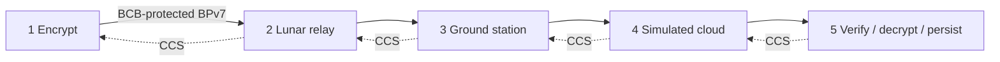

# Five-node video demonstration

The optional lab mission in `demo/five_node.py` builds five independent BPNode/cFS
processes. Node 1 uses BSL to add a payload BCB (AES-256-GCM); nodes 2–4 forward
without a payload key; node 5 authenticates, decrypts, and persists ordered video
segments. Links use the local TCPCLv4 adapter. BPLib supplies CTEB/Compressed
Custody Signals (CCS) and SQLite storage.

**Validation status (2026-10-29):** the fresh native Linux mission build passed,
as did all 16 integration entries and 11 five-process scenarios. These include
baseline transfer/custody drain, all three link outages with relay restart and
the source stopped, lost CCS, node 5 restart, wrong key, missing BCB, altered
ciphertext with valid BP CRC, failed storage commit, and source restart/IV audit.
The final audit observed 20 distinct 96-bit source IVs across process lifetimes.
Wrong-key and missing-BCB cases published no segments or completion. Altered
ciphertext blocked the affected segment and completion while allowing other
independently authenticated segments. Relays ran without payload key files.

The [deployment report](deployment-validation-2026-10-29.md) documents three
additional fixes discovered during this run, failed and successful artifacts,
source/binary fingerprints, and validation limits. Historical October 9 results
remain in the earlier review record; the latest results supersede their counts.

The later [storage transaction follow-up](storage-review-2026-10-29.md) records
20 passing integration entries and three targeted five-process reruns after
additional cleanup/update fixes. The 11-scenario counts above refer to the
earlier full-matrix snapshot.

## Linux and Windows sessions

Use one build terminal and five node terminals on one Linux host. On Windows,
open five Windows Terminal tabs into the **same WSL2 distribution**. These are
Linux executables; the native Windows host-library build does not build cFS.

```powershell
wsl --list --verbose
wsl --distribution Ubuntu
```

Replace `Ubuntu` with your installed distribution. Follow Microsoft's
[WSL installation instructions](https://learn.microsoft.com/en-us/windows/wsl/install)
if needed; see its [command reference](https://learn.microsoft.com/en-us/windows/wsl/basic-commands).
All subsequent commands are Bash commands, including in Windows Terminal.

Keep source, builds, runtime databases, and receipts in the Linux filesystem
(e.g. under your WSL home directory). Windows-mounted source directories can make
cFS builds considerably slower. Do not copy and reuse another checkout's CMake
caches. Set these variables independently in every terminal:

```sh
export BPSEC_WORKSPACE="$HOME/source/bpsec-bplib-integration"
export BPSEC_BUILD="$HOME/bpsec-demo-build"
export BPSEC_RUN="$HOME/bpsec-demo-run"
cd "$BPSEC_WORKSPACE"
```

Use your actual checkout path. A prepared run is one recording; prepare a new
directory for another recording. Keep the same directory and keys for restart.

The [2026-10-29 deployment report](deployment-validation-2026-10-29.md)
records the fresh rebuild with memory/decoder bounds fixes, the TCP I/O timeout
fix found during recovery testing, and the new wrong-key test command.

## Build

First complete the [dependency setup](build-and-test.md#dependencies): BSL and
its staged libraries, CMake, a C99 compiler, Python 3, and the Python requirements.
The repository must contain cFS (cFE, OSAL, PSP, and sch_lab), BPNode, and BPLib.
The demo compiles BPLib as part of cFS; the separate standalone BPLib build is
needed for the general integration tests, not for launching this mission.

```sh
python3 demo/five_node.py build --build-dir "$BPSEC_BUILD"
python3 demo/test_security.py "$BPSEC_BUILD/integration/libbplib_bsl_security.so"
```

The build creates a dedicated mission under `$BPSEC_BUILD/mission` and installs
`core-cpu1`, BPNode/BPLib modules, and tables under
`$BPSEC_BUILD/install/cpu1`. `prepare` copies that install tree into five isolated
runtime directories. Keep the build tree and BSL libraries available during the
run. The generated mission disables unrelated command/telemetry applications
and uses a local BPNode wakeup pulse from the demo worker, so no scheduler
process or shared scheduler table is required.

This enables `BPNODE_ENABLE_FIVE_NODE_DEMO`; normal BPNode builds retain their
existing startup behavior. The lab sets its tables once during initialization,
loads keys only at the endpoints, starts/reconnects contacts, and feeds the source
channel automatically. It accepts no live table updates. It is a fixed loopback
lab configuration, not a remote/cloud deployment tool.

## Prepare a video

Install FFmpeg to create a short synthetic clip (or supply existing MPEG-TS
files named `segment-*.ts`). Run this once in the build terminal:

```sh
mkdir -p "$HOME/bpsec-video-segments"
ffmpeg -hide_banner -y -f lavfi -i testsrc2=size=320x240:rate=10 \
  -t 12 -an -c:v mpeg2video -g 10 -f segment -segment_time 2 \
  "$HOME/bpsec-video-segments/segment-%06d.ts"
python3 demo/five_node.py prepare --build-dir "$BPSEC_BUILD" \
  --run-dir "$BPSEC_RUN" --segment-dir "$HOME/bpsec-video-segments"
```

Use an empty segment directory when generating a new clip so old files cannot
be included. The controller orders filenames, splits files into 4096-byte pieces,
adds a recording identifier and sequence metadata, and records SHA-256 hashes in
`manifest.json`. The final record declares the exact segment count. No video
codec runs inside cFS: it transfers opaque file bytes.

Only `node1/video.key` and `node5/video.key` contain the new 32-byte payload key.
Nodes 2–4 have no key file. Keys and custody state belong to this recording;
keep them together. The Linux run directory and key files use restrictive modes.

## Start five separate sessions

Run the matching command in each terminal, after setting the three variables
above. Start downstream first (5, 4, 3, 2, then 1). Contacts retry if a neighbor
is not yet available. Node 4 represents the simulated cloud on the same host.

| Terminal | Role | Administrative EID | Command |
| --- | --- | --- | --- |
| 1 | Instrument/encrypt | `ipn:10.0` | `python3 demo/five_node.py node --run-dir "$BPSEC_RUN" --node 1` |
| 2 | Lunar relay | `ipn:20.0` | `python3 demo/five_node.py node --run-dir "$BPSEC_RUN" --node 2` |
| 3 | Ground station | `ipn:30.0` | `python3 demo/five_node.py node --run-dir "$BPSEC_RUN" --node 3` |
| 4 | Simulated cloud | `ipn:40.0` | `python3 demo/five_node.py node --run-dir "$BPSEC_RUN" --node 4` |
| 5 | MOC/decrypt | `ipn:50.0` | `python3 demo/five_node.py node --run-dir "$BPSEC_RUN" --node 5` |

Every data bundle retains source `ipn:10.1` and destination `ipn:50.1`.
The listeners are `127.0.0.1:4602` through `:4605`; connections carry data
downstream and CCS administrative bundles upstream. For a second simultaneous
run, prepare a different run directory and pass the same unused `--port-base`
to all five launch commands. The listener port is that base plus node number.
A launcher lock prevents two processes from using the same node directory. Each
process also receives a distinct cFE volatile mount (`/ram1` through `/ram5`) so
native cFS instances do not collide in the host shared-memory filesystem.



## Live playback at node 5

Install FFmpeg with `ffplay` available on `PATH` and use a WSLg-enabled WSL
session (or another Linux display). Start nodes 5, 4, 3, and 2 first. In a sixth
terminal, run this before starting node 1:

```sh
python3 demo/five_node.py view --run-dir "$BPSEC_RUN"
```

The viewer waits for node 5's first fully authenticated, atomically published
segment, then plays the growing output through a local HLS playlist. Playback
advances at completed-segment boundaries (2 seconds with the generated clip).
The player closes when node 5 publishes `output/complete`. For source segments
longer than 2 seconds, pass their maximum duration with `--segment-duration`.

## Watch a folder

For continuous file intake, use a streaming run instead of the finite `prepare`
workflow. The watcher uses FFmpeg to transcode matched files to MPEG-2 video in
MPEG-TS segments; audio is omitted. It waits until a file's size and modification
time are unchanged for `--stable-seconds`, then processes the oldest modification
time first, using filename as a tie-breaker. Files stay under their original
names until node 1 acknowledges them. The run's `watch-state.json` tracks
processed file identities. Use a new, empty incoming folder for a new run.

After rebuilding the mission with the updated demo code, prepare a new run once:

```sh
export BPSEC_RUN="$HOME/bpsec-five-node-stream-1"
export BPSEC_WATCH="/home/banderson777/incoming-video"
mkdir -p "$BPSEC_WATCH"
python3 demo/five_node.py prepare-stream --build-dir "$BPSEC_BUILD" \
  --run-dir "$BPSEC_RUN"
```

In each terminal, set the same `BPSEC_WORKSPACE`, `BPSEC_BUILD`, and `BPSEC_RUN`
values. Start nodes 5, 4, 3, and 2, then start the viewer before node 1. A zero
startup timeout makes the viewer wait indefinitely for the first received file:

```sh
python3 demo/five_node.py view --run-dir "$BPSEC_RUN" --startup-timeout 0
```

Start node 1, then start the folder watcher in its own terminal. The default
pattern is `*.mp4`; set `--pattern` to another shell glob for other FFmpeg-readable
video types. The interval, stability delay, segment duration, and ADU chunk size
are configurable:

```sh
python3 demo/five_node.py watch --run-dir "$BPSEC_RUN" \
  --watch-dir "$BPSEC_WATCH" --pattern '*.mp4' \
  --poll-interval 1 --stable-seconds 2 \
  --segment-duration 2 --chunk-bytes 4096
```

The watcher prints `Node 1 accepted <name>` and renames the source with a `.sent`
suffix after the node-1 acknowledgement arrives. Leave it running to monitor for
more files. To finish the session, wait until it is idle between files and press
Ctrl+C in the watcher terminal; it queues the final record and closes the stream.
Let node 5 publish `output/complete` and the viewer exit before stopping the nodes.
If interrupted during a file's transcode/queue, discard that run and prepare a
fresh stream run; unacknowledged input files remain unrenamed.

Each input file gets a protected end-of-video record after its segments. Node 5
uses it to assemble an atomically published replay copy at
`$BPSEC_RUN/node5/output/videos/video-NNNNNN.ts`. These are MPEG-TS archives of
the transcoded video, not the original MP4 bytes. The parent `manifest.json`
`files` list maps each archive number to its original source name. Live playback
uses FIFO segment order and marks source-file boundaries, so later videos are
appended to the active playlist instead of replacing the current video.

To replay archived videos later in FIFO order:

```sh
for video in "$BPSEC_RUN"/node5/output/videos/video-*.ts; do
  ffplay -autoexit -loglevel error "$video"
done
```

## Verify and play

In the build terminal:

```sh
python3 demo/five_node.py verify --run-dir "$BPSEC_RUN" --timeout 300
```

A successful check prints `PASS` only after authenticated completion and a
byte-for-byte size/hash match for every source segment. Destination files are
`$BPSEC_RUN/node5/output/ground-000000.ts`, etc. Play them with ffplay, or use the
[segment viewer](../client-test/README.md) pointed at this output directory.
A simple sequential playback after verification is:

```sh
for segment in "$BPSEC_RUN"/node5/output/ground-*.ts; do
  ffplay -autoexit -loglevel error "$segment"
done
```

Stop each node with Ctrl+C after verification. Keep logs by redirecting a node's
output to a file or using `tee`. The automated check below waits for both
application delivery and the per-hop custody drain.

For an automated transfer using deterministic bytes instead of a video codec:

```sh
python3 demo/test_five_node.py --build-dir "$BPSEC_BUILD" \
  --run-dir "$HOME/bpsec-five-node-test" --timeout 90
```

This starts all five actual cFS processes, verifies three files byte for byte,
waits for every node's pending custody count to reach zero, stops its child
processes, and retains logs/databases in a new test directory. It needs
permission to bind local sockets. Its synthetic `.ts` inputs test transport,
not playback.

## Persistence and security boundaries

The source adds an RFC 9173 context-2 BCB using BSL's Mock BPA codec/host services
and the actual BSL AES-GCM implementation. The fixed acceptance policy requires
AES-256, AAD scope 7, payload block 1, security source `ipn:10.0`, and the expected
primary source/destination. It rejects missing/duplicate BCBs, bad keys/tags,
fragmented data, and wrong endpoints. Mutable relay extension blocks are outside
this authenticated scope. Administrative CCS bundles are not payload-encrypted.
TCPCL TLS and authenticated CCS are outside this demonstration.

Relays preserve the encoded security block and ciphertext while BPLib updates
forwarding/custody metadata. SQLite uses synchronous FULL commits. At startup the
lab reconstructs pending custody entries from the database, and persists custody
sequence identifiers before a new contact can use them. At node 5, authenticated
chunk receipts and completed segment files are flushed, fsynced, and atomically
renamed before the bundle enters BPLib's custody acceptance path. Duplicate chunk
records must agree exactly. Existing published segments are compared against
their receipts and reused without replacement; missing output can be rebuilt. Incomplete EOF records are rejected for retry.

Restart a node with the same `node` command and runtime directory; do not run
`prepare` again or replace keys. Source restart replays its input records, and
the MOC deduplicates them. The test for relay-only recovery must stop node 1 so
source replay cannot mask a relay recovery failure. These restart/fault scenarios
are not part of the automated baseline run. Process-kill tests do not establish
hardware power-loss durability.

The optional retained-duplicate case closes source ADU feeding after its first
transfer, so restarts replay only the original durable bundle IDs. It holds
upstream acknowledgements, restarts the relay with those same IDs retained,
then checks all five live nodes drain and output/completion bytes and timestamps
stay unchanged. See the [sender/replay review](ccs-sender-review-2026-10-30.md).

## Acceptance tests

| Experiment | Required evidence |
| --- | --- |
| Baseline synthetic transfer | **Passed 2026-10-08:** seven records form three byte-identical output segments; all five custody stores drain |
| Endpoint-only keys | **Passed in baseline:** #2/#3/#4 have no payload key files and forward protected records |
| Each hop's custody | **Passed in baseline:** automated run observed all custodial rows clear after matching CCS processing |
| Break #2→#3 | **Five-process pass:** node 2 retained all nine records; after restoring node 3 and restarting node 2 with node 1 stopped, the output matched byte for byte. |
| Break #3→#4 and #4→#5 | **Five-process pass:** each relay retained all nine records through the outage, then recovered after restart and produced matching output with node 1 stopped. |
| Lose a CCS | **Five-process pass:** the one-shot drop at node 2 fired; retransmission recovered the transfer, all custody drained, and node 5 published completion once. |
| Storage full/failure | **Five-process pass:** an injected SQLite write failure at node 2 withheld custody and node 1 retained all seven records. This simulates write failure rather than exhausting the host filesystem. |
| Restart relay after accepting custody | **Five-process pass** for nodes 2, 3, and 4: each restarted from its existing runtime after holding all nine records, with node 1 stopped, then completed forwarding. |
| Restart #5 | **Five-process pass:** node 5 restarted after a durable receipt, completed the transfer once after reinitialization, and preserved byte-identical segments. |
| Wrong endpoint key or altered protected payload | **Five-process pass:** wrong-key rejection retained node 4 custody. A separate run flipped ciphertext and recalculated the BP payload CRC; node 5 rejected it at BPSec authentication, wrote no completion marker, and node 4 retained custody. |
| Missing BCB | **Five-process pass:** node 5 rejected unprotected payloads, wrote no completion marker, and node 4 retained custody. |
| Nonce/IV audit | **Five-process pass:** 20 unique 96-bit source IVs were recorded across node 1 process restart using the same runtime key. |

Run each link outage in a fresh runtime directory. The fault runner holds the
source until all processes start, disables the receiving process for one hop,
waits until the upstream relay stores the complete test set, then stops node 1
and that relay before restoring the link. The lost-CCS and storage-failure flags
are explicit demo-only injections. Process-kill/restart testing does not alone
establish hardware power-loss durability.

```sh
python3 demo/test_five_node_faults.py --build-dir "$BPSEC_BUILD" \
  --run-dir "$BPSEC_RUN-2-3" --edge 2-3 --port-base 15600
python3 demo/test_five_node_faults.py --build-dir "$BPSEC_BUILD" \
  --run-dir "$BPSEC_RUN-duplicates" --edge 2-3 --replay-retained-duplicates --port-base 15660 \
  --timeout 90
python3 demo/test_five_node_faults.py --build-dir "$BPSEC_BUILD" \
  --run-dir "$BPSEC_RUN-3-4" --edge 3-4 --port-base 15620
python3 demo/test_five_node_faults.py --build-dir "$BPSEC_BUILD" \
  --run-dir "$BPSEC_RUN-4-5" --edge 4-5 --port-base 15640
python3 demo/test_five_node.py --build-dir "$BPSEC_BUILD" \
  --run-dir "$BPSEC_RUN-lost-ccs" --drop-ccs-node 2 --port-base 15740
python3 demo/test_five_node.py --build-dir "$BPSEC_BUILD" \
  --run-dir "$BPSEC_RUN-storage-failure" --storage-fail-node 2 --port-base 15780
python3 demo/test_five_node.py --build-dir "$BPSEC_BUILD" \
  --run-dir "$BPSEC_RUN-wrong-key" --wrong-key --port-base 15810
python3 demo/test_five_node.py --build-dir "$BPSEC_BUILD" \
  --run-dir "$BPSEC_RUN-missing-bcb" --omit-bcb --port-base 15820
python3 demo/test_five_node.py --build-dir "$BPSEC_BUILD" \
  --run-dir "$BPSEC_RUN-tampered-ciphertext" --tamper-ciphertext --port-base 15830
python3 demo/test_five_node.py --build-dir "$BPSEC_BUILD" \
  --run-dir "$BPSEC_RUN-iv-restart" --audit-ivs-across-node1-restart --port-base 15840
python3 demo/test_five_node.py --build-dir "$BPSEC_BUILD" \
  --run-dir "$BPSEC_RUN-node5-restart" --restart-node5-after-receipt --port-base 15800
```

TCPCL acknowledgments, custody signals, BPSec verification, and video playback
are distinct events. The automated baseline checks transfer, endpoint
authentication, byte reconstruction, and custody drain. The five-process fault
and restart results are listed above. These process tests do not establish
hardware power-loss durability or native Windows support.

The subsequent [storage recovery and custody queue review](storage-review-2026-10-29.md)
records 22 integration checks, six sanitizer modes, and a fresh three-scenario
native subset (baseline, middle-relay restart, and storage failure) against the
recovery metadata and queue retry fixes. The older full matrix remains tied to
its recorded binary snapshot.

The [storage completion report](storage-completion-2026-10-29.md) documents the
latest portable recovery and synchronous custody implementation and its full
11-scenario native rerun. Earlier 16/20/22-entry results describe their original
binaries and should not be used as evidence for this newer format.

The [2026-10-30 sender/replay report](ccs-sender-review-2026-10-30.md) records a
fresh twelve-scenario native matrix on the final sender build. It includes a
gated incomplete-receipt receiver restart and original-ID duplicate replay;
older results in the table above remain tied to their recorded snapshots.

The [publication durability follow-up](publication-durability-review-2026-10-30.md)
requires successful directory sync even when a receipt, segment or completion
record already exists on replay. Matching data is reused without rewriting;
persistent sync failures continue to withhold successful delivery.

The [completion-validation follow-up](completion-validation-review-2026-10-30.md)
requires every completed output to match its retained receipt records on EOF
and completion replay. Keep receipts after publication; readable output alone
does not establish completion.
